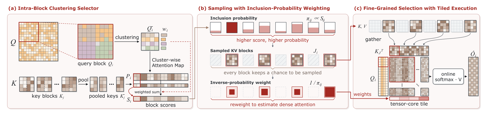

<p align="center">
  <a href="https://www.cardinal-agi.com/">
    
  </a>
</p>

<p align="center">
  <strong>Official repository for AB-Attention</strong>
</p>

<p align="center">
  Accurate Block Attention for Accelerating Video Diffusion Transformers
</p>

<p align="center">
  <a href="https://infrec-cardinal.github.io/AB-Attention/static/papers/ab-attention.pdf"></a>
  <a href="https://arxiv.org/abs/2610.39663"></a>
  <a href="https://github.com/InfRec-Cardinal/AB-Attention"></a>
  <a href="https://infrec-cardinal.github.io/AB-Attention/"></a>
  <a href="#citation"></a>
</p>

<p align="center">
  <a href="#video-level-results">Results</a> &nbsp;/&nbsp;
  <a href="#how-it-works">Method</a> &nbsp;/&nbsp;
  <a href="#citation">Citation</a>
</p>

---

AB-Attention is a training-free sparse attention method for long video sequences. It combines local query clustering, inclusion-probability weighting, and paged GPU execution so that high sparsity does not require dropping the contribution of every unselected block from the attention estimate.

**Code coming soon.** The implementation will be released in this repository.

<p align="center">
  <strong>89–92% attention skipped</strong> &nbsp;·&nbsp; <strong>up to 2.23× end-to-end speedup</strong> &nbsp;·&nbsp; <strong>matched video evaluation</strong>
</p>

## Video-level results

The results below are the paper's end-to-end video measurements on the 600-prompt Penguin Benchmark. Quality is compared with matched dense references; speed is measured against matched dense FlashAttention-3 runs on NVIDIA H20.

| Model | Attention skipped | PSNR | SSIM | LPIPS | Denoising speedup |
| --- | ---: | ---: | ---: | ---: | ---: |
| Wan2.1-T2V · 1.3B | 89.16% | 34.436 | 0.9328 | 0.0734 | **2.01x** |
| Wan2.1-T2V · 14B | 89.16% | 30.788 | 0.9169 | 0.0964 | **1.84x** |
| HunyuanVideo · 13B | 92.35% | 34.347 | 0.9480 | 0.0700 | **2.23x** |

### Same prompt, dense vs. accelerated

The two videos below use the same prompt and generation settings. Play them
directly in the README; the project page contains the full multi-method gallery.

<table>
  <tr>
    <th align="center">Dense attention · original</th>
    <th align="center">AB-Attention · accelerated</th>
  </tr>
  <tr>
    <td align="center">
      <video src="https://github.com/user-attachments/assets/ceb7c049-2812-43d0-868b-c739f5ff982b" poster="https://infrec-cardinal.github.io/AB-Attention/static/images/magpie-dense.webp" controls muted loop playsinline preload="metadata" width="100%" aria-label="Magpie generated with dense attention"></video>
    </td>
    <td align="center">
      <video src="https://github.com/user-attachments/assets/775f227d-857f-4425-9b79-f9c6435419e6" poster="https://infrec-cardinal.github.io/AB-Attention/static/images/magpie-ab-attention.webp" controls muted loop playsinline preload="metadata" width="100%" aria-label="Magpie generated with AB-Attention"></video>
    </td>
  </tr>
</table>

See the [project page](https://infrec-cardinal.github.io/AB-Attention/) for matched dense, AB-Attention, DFSAttn, and SVG2 videos.

## How it works

<p align="center">
  
</p>

1. **Intra-Block Clustering Selector (IBCS)** scores small key/value blocks from query representatives formed within each query block.
2. **Sampling with Inclusion-Probability Weighting (SIP)** samples blocks without replacement and reweights their contribution to the attention normalization.
3. **Paged execution** gathers selected blocks into full attention tiles for efficient GPU execution.

## Citation

```bibtex
@misc{xu2026abattentionaccurateblockattention,
  title = {AB-Attention: Accurate Block Attention for Accelerating Video Diffusion Transformers},
  author = {Bin Xu and Mo Zhang and Zhengfeiyang Zhang and Xinfeng Yang and
            Yixing Ma and Wei Wang and HeXin Wang and Pengfei Zhou and Wangbo Zhao},
  year = {2026},
  eprint = {2610.39663},
  archivePrefix = {arXiv},
  primaryClass = {cs.CV},
  url = {https://arxiv.org/abs/2610.39663}
}
```

## License and acknowledgments

Released under the [MIT License](LICENSE). Inspired by
[DFSAttn](https://github.com/jessica-hujie/DFSAttn) and
[Sparse-VideoGen (SVG2)](https://github.com/svg-project/Sparse-VideoGen).
We also thank [FlashInfer](https://github.com/flashinfer-ai/flashinfer) for its open-source work.
